# Revo

**AI pull-request review that only speaks when it can prove it.**

Revo is a GitHub App. When a pull request is opened or updated, it reads the change with Claude, keeps
only the problems it can defend, turns them into a score out of 100 with a fixed formula, and posts
one comment and a green or red check. A dashboard shows every repo, PR, finding, trend and cost.

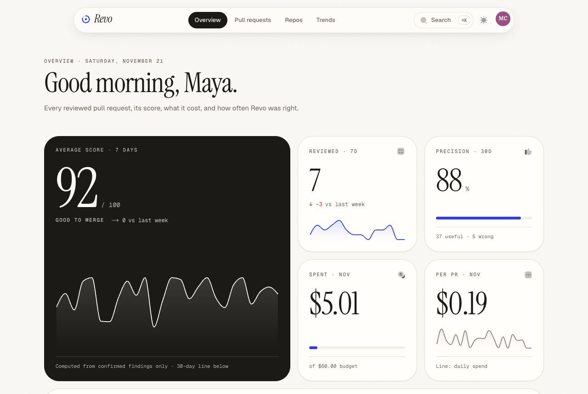

## What makes it different

- **Few comments, all important.** Pass 1 finds problems; pass 2 tries to disprove each one. Only
  survivors are posted, at most five per PR. Rejected findings stay visible in the dashboard with the
  reason they were dropped.
- **An explainable score.** The model never picks the score. `100 − 30 per blocker − 12 per major −
4 per minor (minors capped at 12)`, so the same findings always give the same score and every lost
  point has a line in the comment. Red check on any blocker or below the repo's threshold (70).
- **Measured usefulness.** Every finding has **Useful** / **Wrong** buttons; the overview and trends
  show the real precision rate.
- **Visible cost.** Every comment and review shows tokens and dollars. Prompt caching, a 90-second
  debounce, size limits and a monthly budget per repo keep it bounded.

## Screenshots

|                                                | Light                                            | Dark                                            |
| ---------------------------------------------- | ------------------------------------------------ | ----------------------------------------------- |
| Sign-in (a mini landing page)                  | 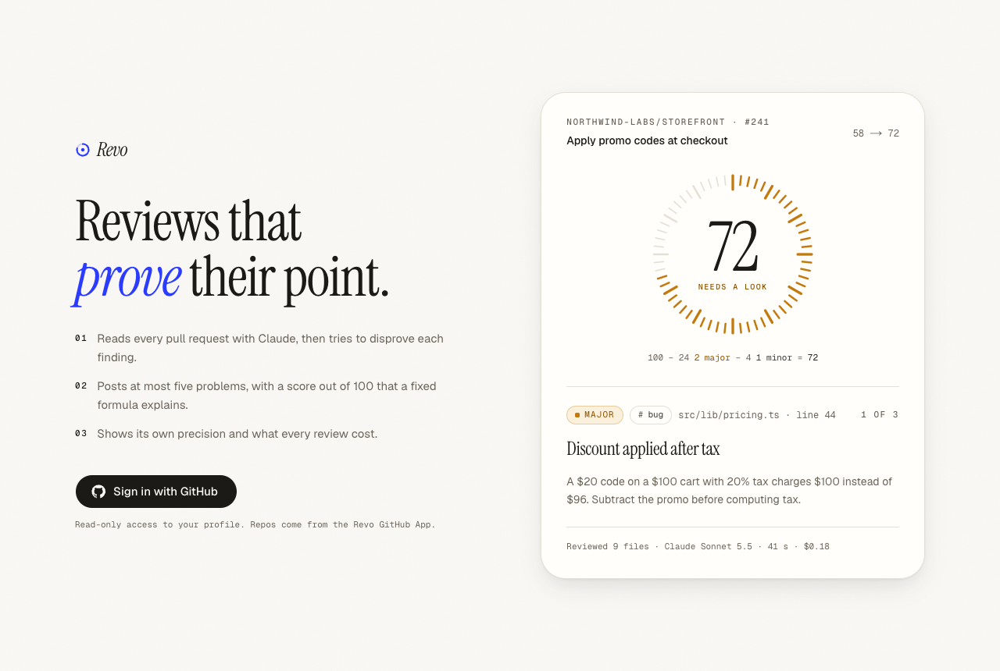  | 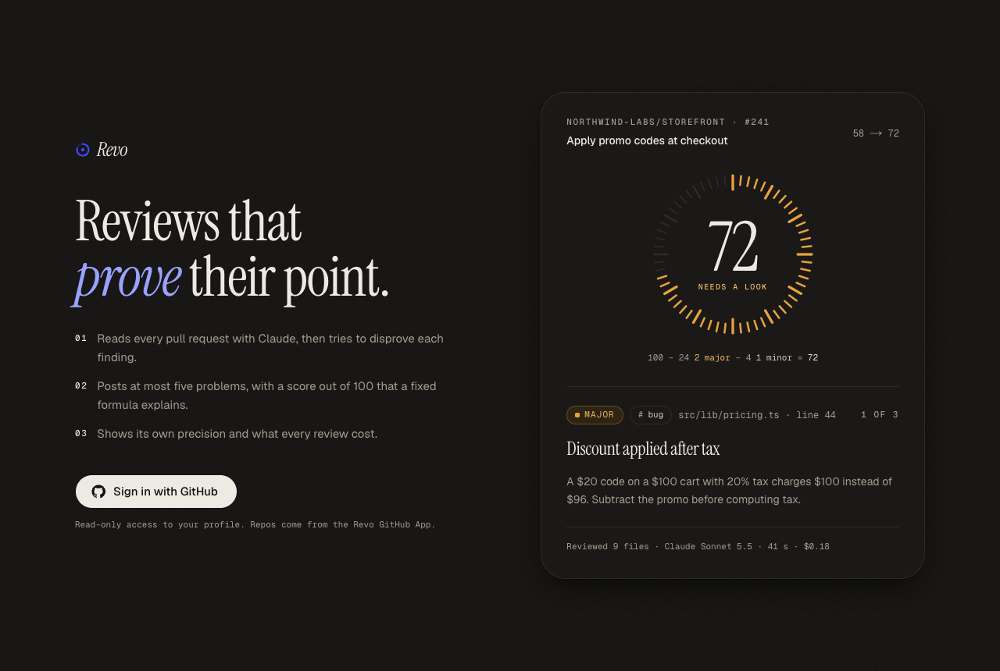  |
| Overview                                       |  | 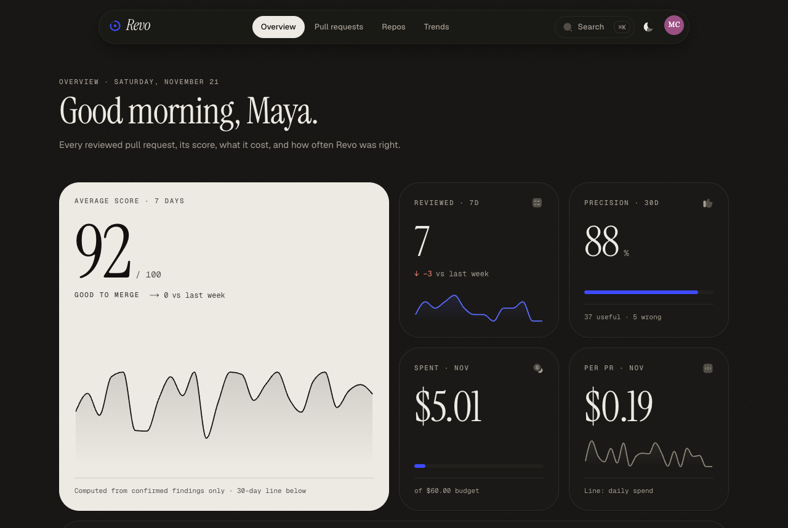 |
| Pull requests                                  | 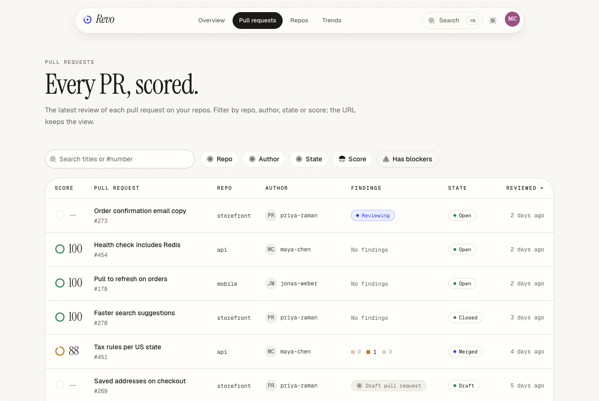      | 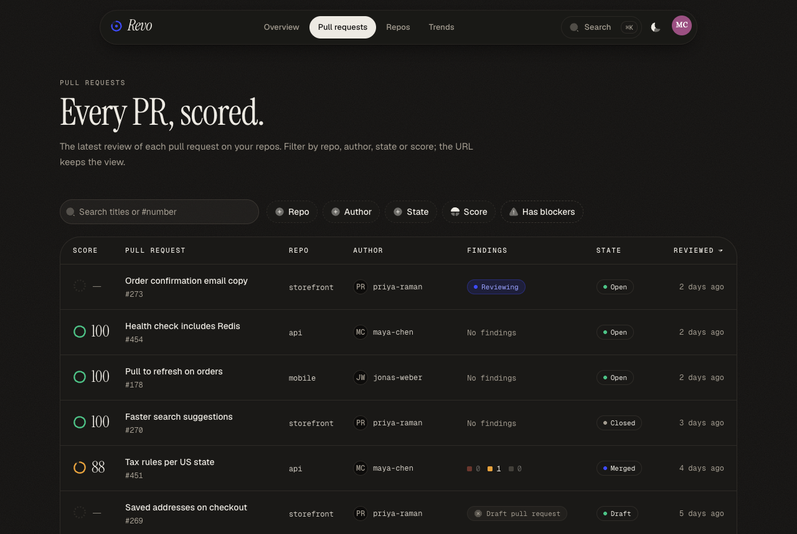      |
| PR detail: score breakdown, findings, feedback | 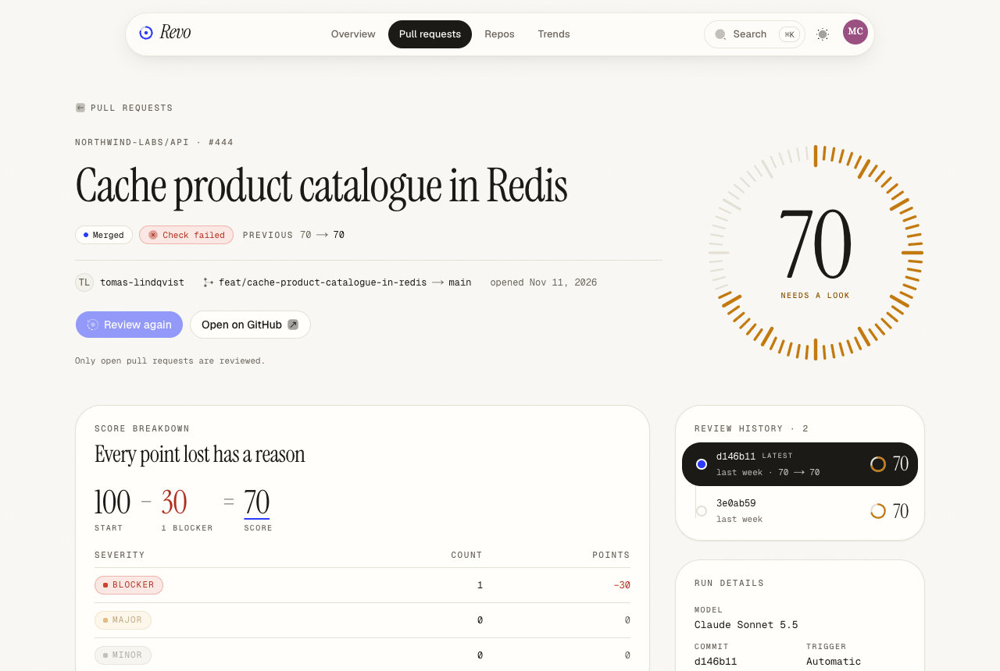       | 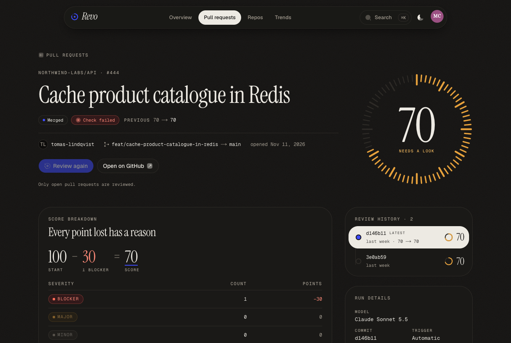       |
| Repos                                          | 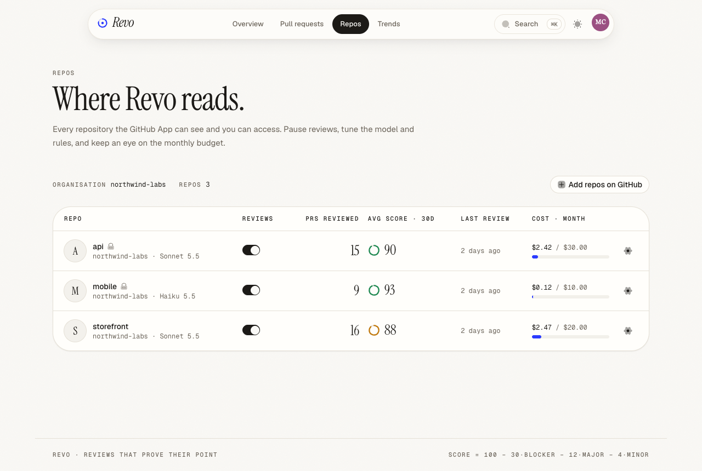    | 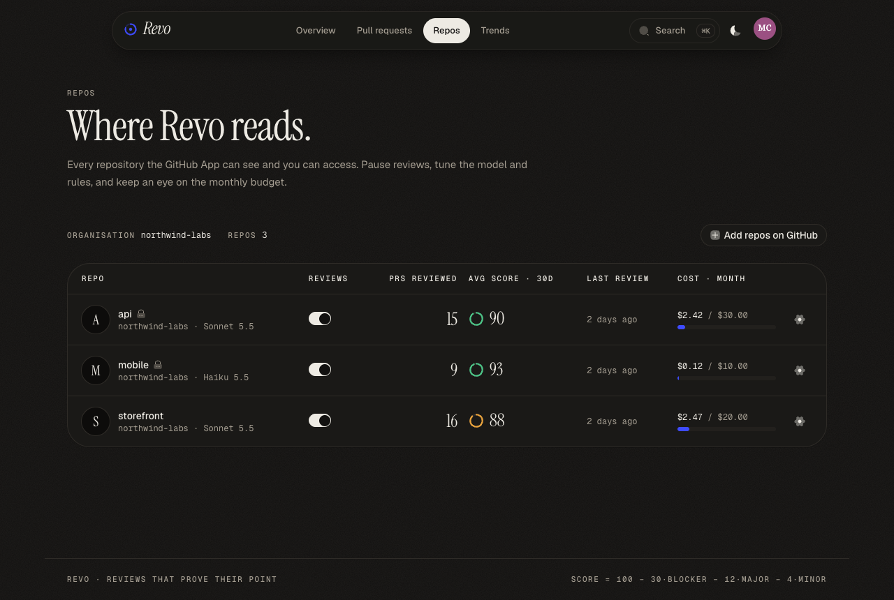    |
| Repo settings                                  | 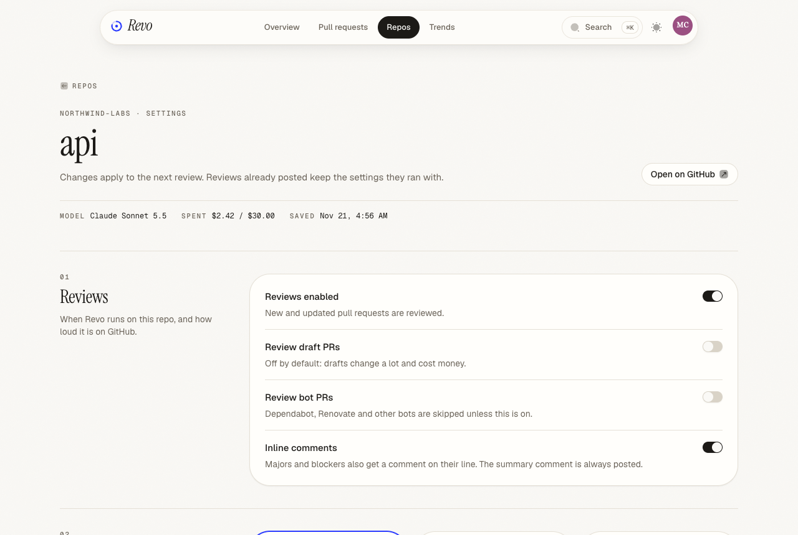 | 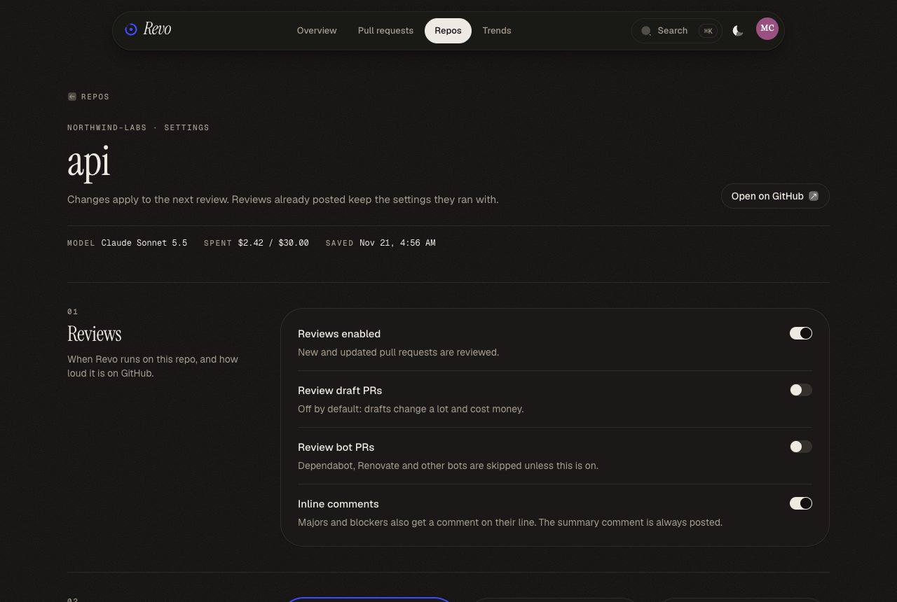 |
| Trends                                         | 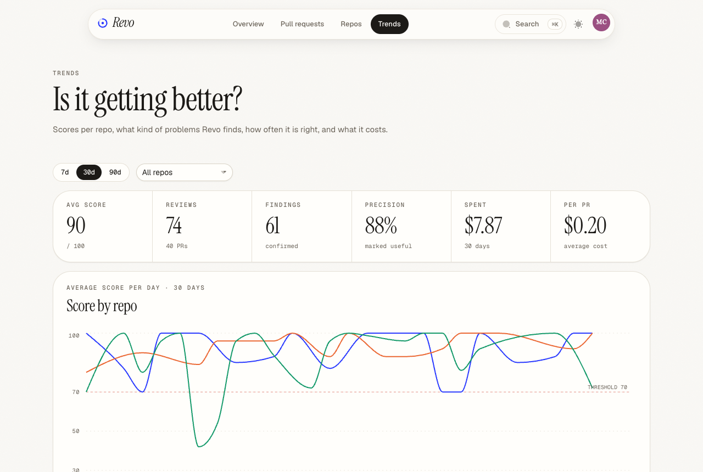   | 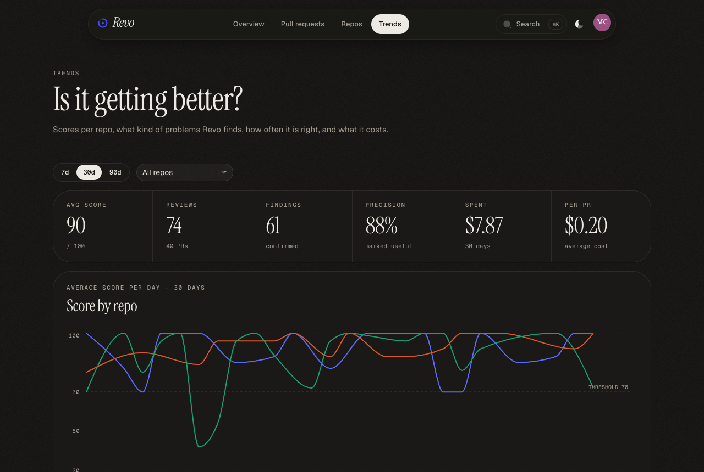   |
| Phone                                          | 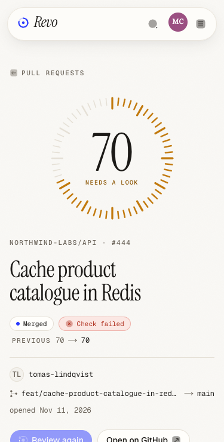         | 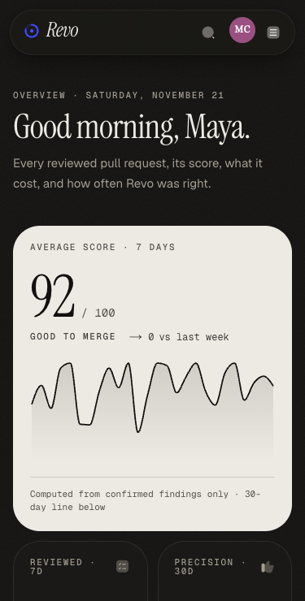   |

Taken from the production build with the demo data (`pnpm db:seed`); every page is checked at 1280,
768 and 375 px in both themes.

## How it works

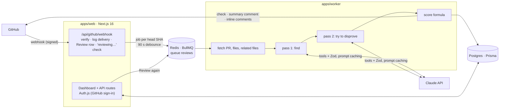

| Package             | What it holds                                                                                                                                                                |
| ------------------- | ---------------------------------------------------------------------------------------------------------------------------------------------------------------------------- |
| `apps/web`          | Dashboard (App Router), webhook route, Auth.js, route handlers → services → presenters                                                                                       |
| `apps/worker`       | BullMQ consumer: skip rules, GitHub fetch, `reviewChanges`, publish, save; retries and failure handling                                                                      |
| `packages/review`   | The engine without GitHub: file filters, size limits, context building, Claude passes, verification, dedupe, snippets, score, pricing; a deterministic fake engine for tests |
| `packages/github`   | Octokit App client, REST helpers, comment and check rendering, inline placement, webhook verification, App manifest                                                          |
| `packages/db`       | Prisma 7 schema, migrations, demo seed                                                                                                                                       |
| `packages/shared`   | Constants, Zod schemas, DTOs, the queue contract, diff parser                                                                                                                |
| `tools/mock-github` | A stand-in for github.com and api.github.com (OAuth, App API, signed webhooks, test hooks)                                                                                   |
| `eval`              | 15 PRs on a demo repo with known answers, and the runner                                                                                                                     |

## Evaluation

`pnpm eval` runs the review engine on 15 PRs against `eval/demo-repo` (a small Next.js shop with an
API and Prisma): 10 with one known bug each (discount after tax, missing auth check, N+1 query,
unhandled error, timezone, off-by-one, race condition, SQL built by string, missing null check,
secret in code) and 5 clean PRs. It prints recall, precision, false alarms, cost and time per PR and
saves the results in `eval/results/`. A bug counts as found only when a posted finding has its file,
its lines (± 3) and its category; one finding is credited per bug (repeats lower precision), and a
run with failed cases does not meet the targets.

| Run                                                             | Bugs found  | Precision | False alarms (5 clean PRs) | Avg cost / PR |
| --------------------------------------------------------------- | ----------- | --------- | -------------------------- | ------------- |
| Offline baseline (`--engine fake`, pattern matching, no Claude) | 3/10        | 3/5       | 0                          | simulated     |
| Claude Sonnet 5.5                                               | not run yet |           |                            |               |
| V1 target                                                       | ≥ 8/10      |           | ≤ 1                        | < $0.30       |

The baseline only checks the harness. The Claude rows need an `ANTHROPIC_API_KEY` in `.env`; then
(about $2 for Sonnet, $0.10 for Haiku):

```sh
pnpm eval --engine claude --model claude-sonnet-5-5 --label sonnet-v1
pnpm eval --engine claude --model claude-haiku-5-5 --label haiku-v1
```

Each run writes `eval/results/<stamp>-claude-<label>.md` with this table and a per-case breakdown.

## Run it locally

Needs Node 24, Postgres and Redis. pnpm comes through `npx` (`corepack enable` works too where
permitted).

```sh
alias pnpm="npx -y pnpm@10.34.9"
pnpm install
pnpm setup:local            # writes .env: Postgres on 5433, Redis db 7, the mock GitHub, fresh secrets
pnpm db:migrate && pnpm db:seed
pnpm mock:github            # terminal 1: mock GitHub on :4830 (sign-in, App API, webhooks)
pnpm dev                    # terminal 2: web on :3830 + worker
```

Open http://localhost:3830 and **Sign in with GitHub**: the mock signs you in as `maya-chen`, who
sees the seeded `northwind-labs` repos. To see a review happen, open a PR through the mock:

```sh
curl -X POST localhost:4830/__mock/repos/northwind-labs/storefront/pulls \
  -H 'content-type: application/json' \
  -d '{"title":"Promo codes","files":[{"path":"src/total.ts","after":"export function total(subtotal: number, tax: number, discount: number) {\n  const taxed = subtotal * (1 + tax);\n  return taxed - discount;\n}\n"}]}'
curl localhost:4830/__mock/repos/northwind-labs/storefront/pulls/1000/activity   # check, comment, inline comments
```

With `REVO_ENGINE=fake` (the default without a key) reviews are deterministic and free. Put an
`ANTHROPIC_API_KEY` in `.env` and leave `REVO_ENGINE` empty to review with Claude. To try the engine
alone on a diff: `pnpm review:local --diff change.patch --repo ./checkout`.

## Tests

```sh
pnpm check                  # typecheck + lint + unit/integration tests in every package (needs Postgres + Redis)
pnpm db:test:prepare        # once: migrations on revo_test
pnpm test:e2e               # production build + Playwright (Chrome, headless) against the mock GitHub
pnpm test:claude            # one PR through the real Claude API (needs ANTHROPIC_API_KEY; a few cents)
```

The end-to-end suite starts the mock GitHub and `next start` on 3831, and its own worker. It covers
sign-in, the dashboard pages, access limits, and the whole product flow: install → a buggy PR gets
a red check, one summary comment and inline comments → feedback moves precision → a new model and
ignored files change the next review → a fix edits the same comment with "Previous review: … → 100"
→ a $0 budget gives a neutral "Monthly budget reached" → a failing Claude API gives a neutral
"Revo couldn't review this PR" while the worker keeps running → uninstall deletes every row.

## Deploy

Docker Compose with Traefik and Let's Encrypt on one EC2 instance: **[DEPLOY.md](./DEPLOY.md)**,
including registering the GitHub App from a manifest (`pnpm github:app --url https://your.domain`).

## For contributors

Commands, ports, contracts, design rules and test recipes: [AGENTS.md](./AGENTS.md). Product spec:
`../docs/specs/verdict-v1-spec.md` (written under a working name; the product is Revo).
